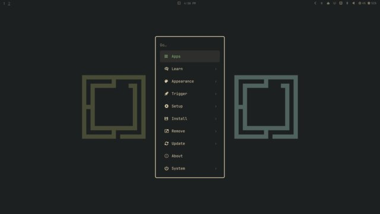
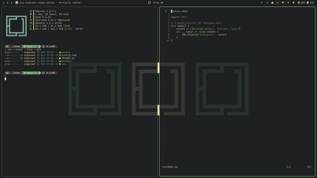
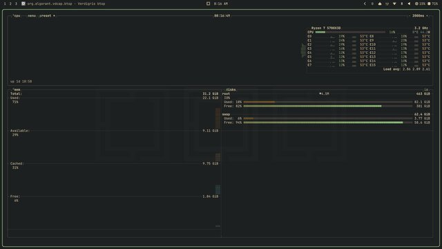
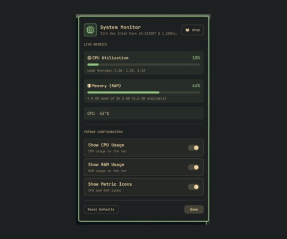
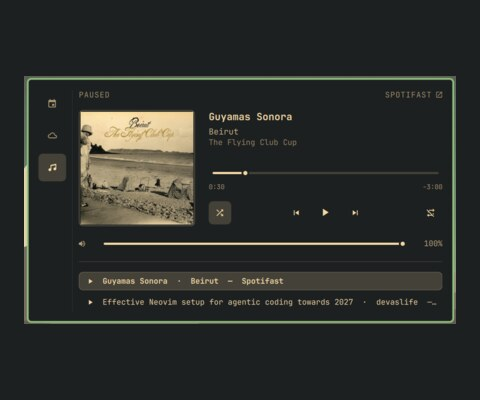
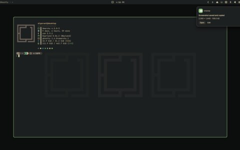
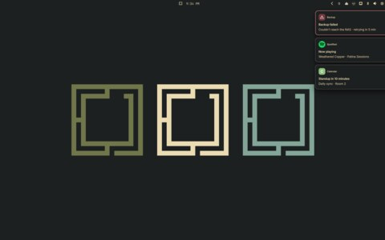
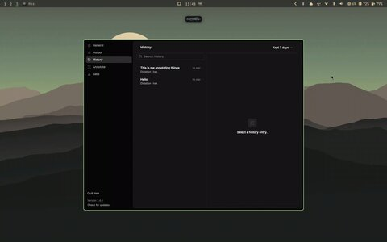

<picture>
  <source media="(prefers-color-scheme: dark)" srcset="images/algOS/algOS-patina-dark-1280.png">
  <source media="(prefers-color-scheme: light)" srcset="images/algOS/algOS-patina-light-1280.png">
  
</picture>

A tailored Omarchy/Arch setup.

## Showcase

## System

- 

widgets

  <table>
    <tr>
      <td align="center"> <a href="plugins/system-monitor/README.md">system monitor</a></td>
      <td align="center"> <a href="plugins/console/README.md">center console</a></td>
    </tr>
  </table>
  

- 

apps

  <table>
    <tr>
      <td align="center"> <a href="https://ghostty.org/">ghostty</a></td>
      <td align="center"> <a href="https://hokum.app">hokum</a></td>
      <td align="center"> hex</td>
    </tr>
  </table>
  

- theme: [verdigris](https://github.com/Algorant/verdigris)

## License

[MIT](LICENSE)
