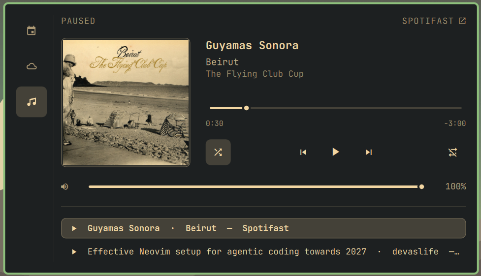

# console

clock, weather and now playing share one popup with calendar, weather and media views.

the rail shows the other two view icons; this frame shows only media.

## files

- [the complete console clone](https://github.com/Algorant/dotfiles/tree/main/home/.config/omarchy/plugins/algorant.console): keep its qml, models and services together.
- [the bar clone](https://github.com/Algorant/dotfiles/tree/main/home/.config/omarchy/plugins/algorant.bar) supplies the shared centre-hover behaviour; see [bar](../bar/README.md).
- the clock part hosts the shared services. clock, weather and media are three bar entries of the same plugin, selected by their `part` settings, not three separate clock widgets.
- media uses mpris. weather uses curl and omarchy's weather-location settings, with requests to open-meteo and wttr.in; choose your own location.

the old `centerAnchor` setting is no longer used. don't copy it from an older readme. arrange the entries in the centre group and review your own shell layout rather than replacing the whole desktop configuration.

[back to the guide](../../README.md)
