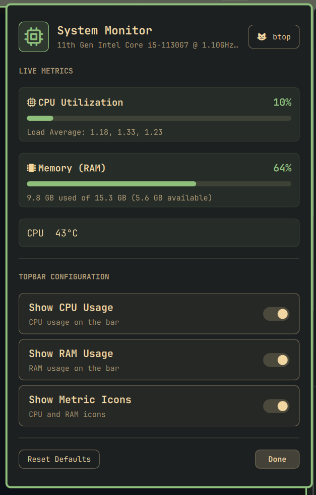

# system monitor

cpu, memory, temperatures and cooling telemetry on the bar, with a details panel.

## files

- [the complete widget](https://github.com/Algorant/dotfiles/tree/main/home/.config/omarchy/plugins/sys-monitor).
- [the power clone](https://github.com/Algorant/dotfiles/tree/main/home/.config/omarchy/plugins/algorant.power) is required too: the widget imports its `Model.js`.
- the panel reads linux proc/sys metrics and optional openlinkhub cooling telemetry. right-click opens btop.
- this local version also changes power profiles and includes a machine-specific camera-service control. review those controls and replace or remove the hardware/service choices before adapting it.

this is not a read-only copy of the upstream widget. [upstream](https://github.com/binoymanoj/sys-monitor-omarchy) is useful context, but installing upstream alone does not supply my controls or the sibling power model.

[back to the guide](../../README.md)
